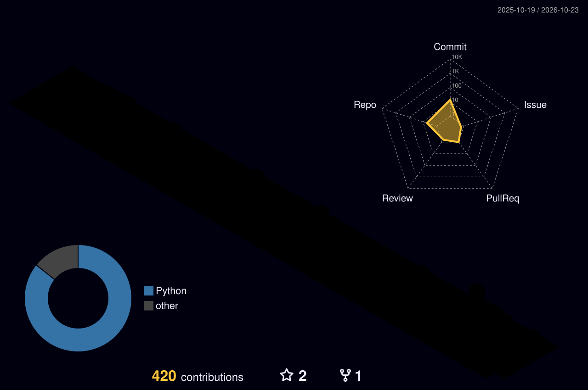

# Hi, I'm Ronald 👋

I'm interested in robotics, embodied AI, VLA, quantitative trading, and full-stack tools.

## 🚀 Current Focus

- Robotics system integration
- VLA / embodied intelligence learning
- ETF and crypto strategy tools

## 📫 Contact

- Email: kline2139@gmail.com
- GitHub: @Ronaldskp

## 📊 GitHub 3D Contribution Graph

After the first successful GitHub Actions run, this graph updates daily.

  

